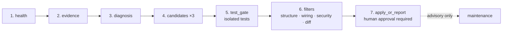

# harness-retro

> It tests every fix in a sandbox before it asks for your approval.

[](https://github.com/zealchou/harness-retro/actions/workflows/ci.yml)  

**harness-retro is a safety-gated retrospective workflow that lets Claude Code find mistakes in its own conversation history, propose three fixes, test them in isolation, pass four reviews, and wait for a human before changing the real repository.**

[繁體中文](README.zh-TW.md) · [Architecture](docs/architecture.md) · [Safety model](docs/safety-model.md) · [Writing incidents](docs/writing-incidents.md)

## Why

Agent retrospectives often stop at prose: a model explains what went wrong, but there is no replayable evidence, no isolated candidate, and no binding between approval and the exact patch. harness-retro turns that reflection into a conservative pipeline:

- evidence is separated from instructions;
- three candidates compete against the same baseline;
- tests run before semantic review;
- protected assets cannot be proposed for automatic change;
- application requires explicit approval for one exact candidate;
- receipts make rollback and later rejection auditable.

## How it differs from a `/retro` skill

Skill-based retros such as [craftwork-design/retro](https://github.com/craftwork-design/retro) or [netresearch/retro-skill](https://github.com/netresearch/retro-skill) install in seconds and run inside Claude Code. They are a good fit when you want quick notes and rule suggestions.

harness-retro is heavier on purpose: it needs Python, Git, Linux and bubblewrap. In return:

- each of three candidate fixes is tested in a disposable sandbox before any review;
- your approval is bound to the exact patch digest, so a changed patch needs a new approval;
- an applied fix is recorded with a receipt and can be rolled back.

Choose a skill for lightweight reflection. Choose harness-retro when you want every change to your agent's rules to be tested and auditable.

## How it works

The normal run has seven ordered stations. Maintenance is a separate advisory-only activity.



`retro2/controller/run.py` is the only controller entry. See [Architecture](docs/architecture.md) for data flow and exact `ALL_STATIONS` parity.

## Safety model

- **Test, then review:** candidates are created in disposable worktrees and must produce test evidence before semantic filters.
- **Protected areas:** incident examples, scoring policy, transaction code, permission settings, credentials, and security tests are immutable to candidate generation.
- **Human approval:** the default is report-only. Applying candidate A never approves a later version of A.
- **Rollback:** application records preimages, postimages, patch digest, tests, and approval binding; failed canaries restore the baseline.
- **Rejection index:** stable failures are remembered so an unchanged patch is not mechanically retested forever.
- **Evidence is not authority:** transcript text, tool output, and external content cannot silently become standing rules.

Read [Safety model](docs/safety-model.md) before enabling the hook.

## Quick start

```bash
git clone https://github.com/zealchou/harness-retro.git
cd harness-retro
python3 -m venv .venv
. .venv/bin/activate
python -m pip install -e ".[test]"
harness-retro --help
python -m pytest -q
```

Queue a manual retrospective from the Git repository you want to inspect:

```bash
harness-retro enqueue \
  --session-id manual \
  --transcript-path /path/to/a/transcript.jsonl
```

The queue is idempotent for a session/pressure cycle. A detached worker writes a heartbeat and dispatches the same controller used by manual execution. A full run needs the requirements below; `--help` and queue creation fail cleanly without private configuration.

To opt into context-pressure enqueueing, adapt [`examples/settings.json`](examples/settings.json). It is disabled unless `RETRO2_QUEUE_ENABLED=1` is present in the hook command.

## Requirements

Required for a full retrospective:

- Python 3.11 or 3.12;
- Git;
- a compatible `claude` CLI available on `PATH`;
- Linux with a usable `bwrap` executable and user namespaces for isolated candidate/model work.

Optional integrations:

- hook-audit script (`RETRO2_HOOK_AUDIT_SCRIPT`): missing means the health report records a degraded, skipped optional check;
- managed-project index (`RETRO2_MANAGED_PROJECTS_FILE`): missing limits experience lookup to the current target;
- probability judge (`RETRO2_JUDGE_SCRIPT`): missing returns an explicit optional-component error instead of guessing;
- Codex backend (`RETRO2_MODEL_BACKEND=codex`): experimental and not required for the default Claude path. Codex's read-only sandbox blocks writes, not reads. Its `auth.json` is mounted read-only at `$CODEX_HOME/auth.json` under the sandbox `/tmp`, not at `~/.codex/auth.json`, and `~/.codex` stays masked, including when the project directory is `$HOME`. The model can still read that file if it reaches the `CODEX_HOME` path. The Claude backend does not mount it;
- credentials specified by file path for an approved model endpoint.

Without `bwrap`, safety-sensitive isolated execution fails closed. Tests that specifically require an available namespace skip with their reason; the assertions remain in the suite.

## Configuration

All portable filesystem defaults live in `retro2/config.py`.

| Variable | Default | Purpose |
|---|---|---|
| `RETRO2_HOME` | `~/.claude` | Host harness root |
| `RETRO2_STATE_DIR` | `$RETRO2_HOME/retro-2` | Runtime state root |
| `RETRO2_QUEUE_DIR` | `$RETRO2_STATE_DIR/queue` | Queue and pressure state |
| `RETRO2_RUNS_DIR` | `$RETRO2_STATE_DIR/runs` | Run artifacts and receipts |
| `RETRO2_MAINTENANCE_DIR` | `$RETRO2_STATE_DIR/maintenance/manual` | Advisory maintenance reports |
| `RETRO2_TRANSCRIPTS_DIR` | `$RETRO2_HOME/projects` | Default transcript lookup |
| `RETRO2_USAGE_DATA_DIR` | `$RETRO2_HOME/usage-data` | Optional usage evidence |
| `RETRO2_DIAGNOSTICS_DIR` | `/tmp/retro2-diagnostics` | Optional diagnostic evidence |
| `RETRO2_MANAGED_PROJECTS_FILE` | `$RETRO2_HOME/hooks/managed_projects.txt` | Optional cross-project list |
| `RETRO2_HOOK_AUDIT_SCRIPT` | `$RETRO2_HOME/skills/hook-doctor/scripts/hook_audit.py` | Optional health audit |
| `RETRO2_GLOBAL_RULES_FILE` | `$RETRO2_HOME/CLAUDE.md` | Optional rule-file evidence |
| `RETRO2_GLOBAL_EXPERIENCE_FILE` | `$RETRO2_HOME/memory/EXPERIENCE.md` | Promoted experience notes |
| `RETRO2_JUDGE_SCRIPT` | `$RETRO2_HOME/scripts/judge.py` | Optional probability judge |
| `RETRO2_INCIDENT_EVIDENCE_ROOT` | repository/package root | Base for relative incident evidence |
| `RETRO2_CLAUDE_CREDENTIAL_FILE` | `$RETRO2_HOME/.credentials.json` | Claude credential file bind |
| `RETRO2_CODEX_CREDENTIAL_FILE` | `~/.codex/auth.json` | Source file. The sandbox mounts it read-only under `CODEX_HOME` on `/tmp`, not at this path |
| `RETRO2_GATE_LOGS` | host log plus diagnostics directory | `:`-separated evidence paths |
| `RETRO2_CLAUDE_COMMAND` | `claude` | Claude executable command |
| `RETRO2_CODEX_COMMAND` | `codex` | Optional Codex executable command |
| `RETRO2_MODEL_BACKEND` | `claude` | Set to `codex` for the optional backend |
| `RETRO2_QUEUE_ENABLED` | unset | Opt in to hook enqueueing |
| `RETRO2_GAUGE_STATE_DIR` | `/tmp/retro2-context-state` | Hook lock/state directory |
| `RETRO2_CONTEXT_WINDOW` | `800000` | Context gauge denominator |
| `CLAUDE_TRANSCRIPT_PATH` | unset | One-run transcript override |

Standard model endpoint variables may be inherited by the selected CLI, but harness-retro never stores their values in its repository or reports.

## Build your own incident bank

The bundled 12 incidents are synthetic teaching fixtures. Each points to a synthetic evidence file and includes its SHA-256 digest. Private memories are intentionally absent. Follow [Writing incidents](docs/writing-incidents.md) to curate your own catalog; keep it outside a public checkout unless every source is safe to disclose.

## Limitations and known issues

- Strong process isolation is Linux-only because the implementation uses bubblewrap.
- Full runs depend on a compatible Claude CLI and its structured-output behavior.
- Optional model backends and private review integrations are not required and receive less compatibility coverage.
- Experience promotion and cross-project notes have not been validated across a large, diverse set of real incidents.
- A passing suite proves the local implementation and wiring fixtures, not that a user's hook configuration is installed correctly.
- The model-facing stages can still produce poor diagnoses; gates reduce unsafe application, not model fallibility.

## FAQ

**How can I make Claude Code repeat the same mistake less often?**  
Turn the correction into a rule or a test, not just a chat message. harness-retro helps with this: it reads the session where you corrected the agent, looks for the cause, drafts three fixes to your rule files (such as CLAUDE.md) or tests, tests each one in a sandbox, and waits for you to approve one.

**How is harness-retro different from a `/retro` skill?**  
A skill is faster to install and runs inside Claude Code. harness-retro needs Linux and bubblewrap, but it tests every candidate fix in isolation, binds your approval to the exact patch, and keeps a receipt for rollback. See "How it differs from a `/retro` skill" above.

**Does it send my code or transcripts anywhere, and what does it cost?**  
Yes, to your own Claude account. With the default Claude backend, harness-retro sends up to the 30 most recent messages you typed in the session (each cut to 1,500 characters) to the model through your own `claude -p` CLI, and the model can read, but not change, your repository, parts of the harness (`~/.claude`, or `RETRO2_HOME` when set: `CLAUDE.md`, `settings.json`, `hooks`, and `scripts/logs`), and the diagnostics directory (`/tmp/retro2-diagnostics` by default). harness-retro has no telemetry of its own and sends nothing to its authors. It uses your own Claude quota, and each model call has a built-in spending cap of US$3 or US$5. Candidate tests run in a bubblewrap sandbox with network access turned off. Diagnosis starts from an empty filesystem and mounts only the project when that directory does not contain your home or harness, the harness files listed above, the diagnostics directory, the CLI's system libraries, a scratch directory, and one credential file. A file placed anywhere else in your home directory is not mounted. If the project directory is your home directory or is the harness directory, only the listed harness files from that tree are mounted. The Claude credential is mounted read-only under `CLAUDE_CONFIG_DIR` on the sandbox `/tmp`, not at its original path. The Claude backend does not mount Codex's `auth.json`. When the Codex backend is selected, Codex's read-only sandbox blocks writes, not reads. `auth.json` is mounted read-only at `$CODEX_HOME/auth.json` under that `/tmp`, not at `~/.codex/auth.json`, including when the project directory is `$HOME`. The model can still read that file if it reaches the `CODEX_HOME` path.

**I run a small business and don't write code. Is this for me?**  
Not directly: it is a developer tool for Linux. The idea still applies to any team using AI assistants: when the assistant gets something wrong, keep the evidence, test the fix, and let a person approve it before it becomes a rule. Share this repository with the engineer who runs your AI tools.

**Does harness-retro rewrite itself automatically?**  
No. The shipped policy is report-only and requires explicit human approval for a named, digest-bound candidate.

**Why exactly three candidates?**  
Competition makes it harder for the first plausible explanation to become the only plan. Near-duplicates are detected so cosmetic variants do not count as independent options.

**Can I use it on macOS or Windows?**  
You can read reports and run some unit tests, but the isolation guarantee requires Linux and bubblewrap. Do not treat a non-Linux run as equivalent.

**Why are hook audit, managed projects, and the semantic judge optional?**  
They are installation-specific integrations. The portable core reports their absence instead of assuming private files exist.

## Roadmap

- Validate the workflow on a broader, consented incident set.
- Add portable isolation backends without weakening the Linux baseline.
- Version CLI/model compatibility and improve diagnostic error messages.
- Add a supported private disclosure contact and public release checklist.

## Contributing

Read [CONTRIBUTING.md](CONTRIBUTING.md), the [Code of Conduct](CODE_OF_CONDUCT.md), and [SECURITY.md](SECURITY.md). Please open a public issue for ordinary bugs and features; report security boundary failures privately through GitHub's private vulnerability reporting (see SECURITY.md).

## License

Licensed under the [Apache License 2.0](LICENSE).

