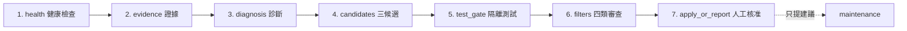

# harness-retro

> 每一種改法都先在沙盒裡測過，才來問你要不要用。

[](https://github.com/zealchou/harness-retro/actions/workflows/ci.yml)  

**harness-retro 是一套有安全閘門的回顧工作流：讓 Claude Code 從自己的對話紀錄找出失誤、提出三個候選改法、隔離測試、通過四類審查，最後等人明確批准才改正式倉庫。**

[English](README.md) · [架構](docs/architecture.md) · [安全模型](docs/safety-model.md) · [撰寫事故題庫](docs/writing-incidents.md)

## 為什麼需要它

常見的 agent 回顧只停在文字反省：模型說明哪裡錯了，卻沒有可重播證據、隔離候選，也沒有把人的核准綁到確切補丁。harness-retro 把反省收斂成保守管線：

- 證據與指令分開；
- 三個候選在同一基準競爭；
- 先測試，再做語意審查；
- 不可改區不能被候選自動變更；
- 套用前必須明確批准一個確切候選；
- 收據可供撤回、追蹤與拒絕索引使用。

## 跟 `/retro` 類 skill 有什麼不同

像 [craftwork-design/retro](https://github.com/craftwork-design/retro)、[netresearch/retro-skill](https://github.com/netresearch/retro-skill) 這類 skill，幾秒就裝好，在 Claude Code 裡打一個指令就能用，適合想快速整理心得、得到規則建議的人。

harness-retro 刻意做得比較重：要 Python、Git、Linux 和 bubblewrap。換來的是：

- 三種候選改法，每一種都先在拋棄式沙盒裡測過，才進入審查；
- 你的批准綁定在那一份補丁的指紋上，補丁一改就要重新批准；
- 套用後留下收據，可以還原。

想輕鬆回顧，用 skill；想讓每一次修改 AI 規則都先測過、事後查得到，用 harness-retro。

## 七站流程

正常執行共有七站；maintenance 是獨立、只提建議的第八個活動。



唯一 controller 入口是 `retro2/controller/run.py`，一般透過 `harness-retro` 指令使用。完整資料流與 `ALL_STATIONS` 對照見[架構文件](docs/architecture.md)。

## 安全模型

- **先測再審：**候選在一次性 worktree 產生，必須先留下測試證據。
- **不可改區：**事故範例、評分政策、交易程式、權限設定、憑證路徑與安全測試受保護。
- **人批准：**預設只出報告；舊版 A 的批准不能拿來批准後來改過的 A。
- **可撤回：**套用收據綁定前後映像、補丁雜湊、測試與批准；canary 失敗就回到基準。
- **拒絕索引：**相同補丁的穩定失敗不會永遠重測。
- **證據不是權威：**逐字稿、工具輸出與外部內容不能自行升格成常駐規則。

啟用 hook 前請先讀[安全模型](docs/safety-model.md)。

## 快速開始

```bash
git clone https://github.com/zealchou/harness-retro.git
cd harness-retro
python3 -m venv .venv
. .venv/bin/activate
python -m pip install -e ".[test]"
harness-retro --help
python -m pytest -q
```

在要檢查的 Git 倉庫中手動排入：

```bash
harness-retro enqueue \
  --session-id manual \
  --transcript-path /path/to/a/transcript.jsonl
```

queue 對同一個 session／壓力週期具冪等性。背景 worker 會寫 heartbeat，再呼叫與手動執行相同的 controller。完整執行需要下列環境；`--help` 與排入動作不依賴私人設定，也不應吐 traceback。

若要啟用 context 壓力自動排入，請調整 [`examples/settings.json`](examples/settings.json)。只有 hook 指令明確設定 `RETRO2_QUEUE_ENABLED=1` 才會啟用。

## 需求

完整執行的必要條件：

- Python 3.11 或 3.12；
- Git；
- `PATH` 上有相容的 `claude` CLI；
- Linux、可用的 `bwrap`，以及允許建立 user namespace 的核心設定。

可選整合：hook-audit 腳本、受管專案索引、語意事故判斷器、Codex 後端與指定的模型憑證檔。找不到可選元件時，程式會記錄清楚的 skip／降級／錯誤原因，不會假裝執行成功。沒有 `bwrap` 時，安全敏感的隔離執行會 fail closed；需要真 namespace 的測試可附原因 skip，但斷言保留。

## 設定

所有可攜式路徑預設集中在 `retro2/config.py`。

| 變數 | 預設值 | 用途 |
|---|---|---|
| `RETRO2_HOME` | `~/.claude` | host harness 根目錄 |
| `RETRO2_STATE_DIR` | `$RETRO2_HOME/retro-2` | 執行狀態根目錄 |
| `RETRO2_QUEUE_DIR` | `$RETRO2_STATE_DIR/queue` | queue 與壓力狀態 |
| `RETRO2_RUNS_DIR` | `$RETRO2_STATE_DIR/runs` | run 產物與收據 |
| `RETRO2_MAINTENANCE_DIR` | `$RETRO2_STATE_DIR/maintenance/manual` | 淘汰建議報告 |
| `RETRO2_TRANSCRIPTS_DIR` | `$RETRO2_HOME/projects` | 預設逐字稿目錄 |
| `RETRO2_USAGE_DATA_DIR` | `$RETRO2_HOME/usage-data` | 可選使用紀錄證據 |
| `RETRO2_DIAGNOSTICS_DIR` | `/tmp/retro2-diagnostics` | 可選診斷證據 |
| `RETRO2_MANAGED_PROJECTS_FILE` | `$RETRO2_HOME/hooks/managed_projects.txt` | 可選跨專案清單 |
| `RETRO2_HOOK_AUDIT_SCRIPT` | `$RETRO2_HOME/skills/hook-doctor/scripts/hook_audit.py` | 可選 hook 健檢 |
| `RETRO2_GLOBAL_RULES_FILE` | `$RETRO2_HOME/CLAUDE.md` | 可選全域規則證據 |
| `RETRO2_GLOBAL_EXPERIENCE_FILE` | `$RETRO2_HOME/memory/EXPERIENCE.md` | 升格後經驗筆記 |
| `RETRO2_JUDGE_SCRIPT` | `$RETRO2_HOME/scripts/judge.py` | 可選機率判斷器 |
| `RETRO2_INCIDENT_EVIDENCE_ROOT` | 倉庫／套件根目錄 | 相對事故證據基準 |
| `RETRO2_CLAUDE_CREDENTIAL_FILE` | `$RETRO2_HOME/.credentials.json` | Claude 憑證唯讀掛載 |
| `RETRO2_CODEX_CREDENTIAL_FILE` | `~/.codex/auth.json` | 可選 Codex 憑證唯讀掛載 |
| `RETRO2_GATE_LOGS` | host log 與診斷目錄 | 以 `:` 分隔的證據路徑 |
| `RETRO2_CLAUDE_COMMAND` | `claude` | Claude 執行命令 |
| `RETRO2_CODEX_COMMAND` | `codex` | 可選 Codex 執行命令 |
| `RETRO2_MODEL_BACKEND` | `claude` | 設為 `codex` 使用可選後端 |
| `RETRO2_QUEUE_ENABLED` | 未設定 | 明確啟用 hook 排入 |
| `RETRO2_GAUGE_STATE_DIR` | `/tmp/retro2-context-state` | hook lock／狀態目錄 |
| `RETRO2_CONTEXT_WINDOW` | `800000` | context gauge 分母 |
| `CLAUDE_TRANSCRIPT_PATH` | 未設定 | 單次逐字稿覆寫 |

選定的 CLI 可能繼承標準模型端點變數；harness-retro 不會把它們的值寫進倉庫或報告。

## 建立自己的事故題庫

內附 12 題全是合成教學範例，每題都指向合成證據檔並附 SHA-256。私人記憶與真實逐字稿刻意不收錄。請依[事故題庫指南](docs/writing-incidents.md)建立自己的 catalog；來源只要不適合公開，就應留在公開 checkout 之外。

## 限制與已知問題

- 強隔離依賴 bubblewrap，因此目前只有 Linux 具完整保證。
- 完整流程依賴相容的 Claude CLI 與其結構化輸出行為。
- 可選模型後端與私有審查整合不是核心必要條件，相容性覆蓋較少。
- 經驗升格與跨專案筆記尚未在大量、多樣的真實事故上驗證。
- 測試全綠只證明本機實作與 fixture 接線，不代表使用者的 hook 已正確裝上正式環境。
- 模型仍可能做出差的診斷；閘門降低的是不安全套用，不是消除模型錯誤。

## FAQ

**怎麼讓 Claude Code 減少重犯同一個錯？**  
把糾正寫成規則或測試，而不是只在對話裡講一次。harness-retro 幫你做這件事：它讀你糾正 AI 的那段對話，找出可能的原因，針對規則檔（例如 CLAUDE.md）或測試提出三種改法，各自在沙盒裡測試，等你批准其中一個。

**harness-retro 跟 `/retro` 類 skill 有什麼不同？**  
skill 裝起來比較快，直接在 Claude Code 裡跑。harness-retro 要 Linux 和 bubblewrap，但每一種改法都先隔離測試，你的批准綁定在確切的補丁上，而且留有收據可以還原。詳見上方「跟 `/retro` 類 skill 有什麼不同」。

**它會把我的程式碼或對話紀錄傳到別的地方嗎？要花多少錢？**  
會，傳給你自己帳號下的 Claude。使用預設的 Claude 後端時，harness-retro 會把這段對話裡你最近打的最多 30 則訊息（每則最多 1,500 字）透過你自己的 `claude -p` 指令送給模型，模型也可以唯讀讀取你的專案、`~/.claude` 的一部分（`CLAUDE.md`、`settings.json`、`hooks` 和 `scripts/logs`），以及診斷目錄（預設是 `/tmp/retro2-diagnostics`），但不能修改。harness-retro 本身不回傳任何使用資料，也不會把資料送給作者。它用你自己的 Claude 額度，每次呼叫模型內建 3 或 5 美元的花費上限。候選改法的測試在 bubblewrap 沙盒裡進行，網路是關掉的。

**我是中小企業老闆、不會寫程式，這個適合我嗎？**  
不直接適合：這是給 Linux 開發者用的工具。但背後的做法任何用 AI 助手的團隊都用得上：AI 做錯時留下證據、先測試改法、由人批准後才變成規則。可以把這個專案轉給負責你們 AI 工具的工程師看。

**會自動改自己嗎？** 不會。發行設定預設只出報告，必須由人批准綁定雜湊的具名候選。

**為什麼一定三個候選？** 避免第一個看似合理的解釋變成唯一方案；近似重複的補丁不算獨立選項。

**macOS／Windows 能用嗎？** 可讀報告、跑部分單元測試，但完整隔離保證需要 Linux＋bubblewrap。

**為何有些整合是可選？** hook audit、受管專案與語意判斷器都是安裝場域專屬；開源核心應誠實回報缺少，不該假設私人檔案存在。

## Roadmap

- 用更多經同意、可公開驗證的事故檢驗流程。
- 在不削弱 Linux 基準的前提下加入其他隔離後端。
- 版本化 CLI／模型相容矩陣並改善錯誤訊息。
- 補上私人漏洞回報聯絡方式與正式發布清單。

## 貢獻與授權

請先讀 [CONTRIBUTING.md](CONTRIBUTING.md)、[CODE_OF_CONDUCT.md](CODE_OF_CONDUCT.md) 與 [SECURITY.md](SECURITY.md)。

採用 [Apache License 2.0](LICENSE) 授權。

