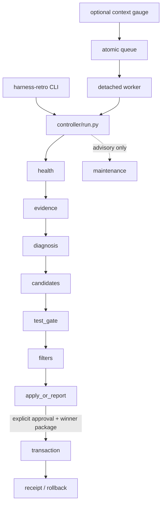

# Architecture

## Purpose and boundary

harness-retro converts retrospective evidence into tested candidate patches without treating model output as authorization. The controller owns orchestration; adapters are deliberately narrow and do not call one another to skip stages.

## Single entry point

The installed `harness-retro` command delegates to `retro2/controller/run.py`. No secondary entry point may invoke controller internals directly. Manual enqueue, pressure-triggered enqueue, detached workers, saved-run application, and maintenance all return to this boundary.



The apply boundary consumes a validated winner package; it does not accept free-form model prose. No secondary entry point is permitted.

## Station order

`retro2/controller/run.py` defines:

```python
ALL_STATIONS = (
    "health",
    "evidence",
    "diagnosis",
    "candidates",
    "test_gate",
    "filters",
    "apply_or_report",
    "maintenance",
)
```

The main execution slice is the first seven values. `maintenance` is advisory-only and is invoked separately; it cannot return patch or command fields. The diagram includes every `ALL_STATIONS` value and preserves this order.

## Data flow

| Stage | Reads | Writes | Stop examples |
|---|---|---|---|
| health | CLI availability, optional audit | health verdict and degradation reasons | required CLI failure |
| evidence | transcript, diagnostics, rule volumes | provenance and observation records | no trusted or machine incident |
| diagnosis | bounded evidence | findings and candidate requirements | unreplayable/uncited claim |
| candidates | requirements and allowed files | three anonymous candidate manifests | protected path or duplicate |
| test_gate | candidate worktrees | command results and coverage status | failed test or isolation error |
| filters | diff plus test evidence | structure, wiring, security, and diff reviews | reproducible blocker |
| apply_or_report | qualified winner and approval | report or transaction receipt | missing/mismatched approval |
| maintenance | read-only snapshot | advisory reports | invalid action-shaped output |

## Configuration and runtime state

`retro2/config.py` is the one source for portable filesystem defaults. Runtime state belongs under `RETRO2_STATE_DIR`; it is ignored by Git. Synthetic public examples live under `examples/`, never in runtime state.

The optional integrations—hook audit, managed-project list, probability judge, diagnostics, and Codex backend—are leaves. The probability judge is configured by `RETRO2_JUDGE_SCRIPT` and consumes each incident's `judge_question`. Missing leaves must yield a specific skip, degradation, or error and must not change the seven-stage order.

## Isolation

Candidate generation and qualification use disposable Git worktrees. On Linux, `host_exits.run_restricted` uses bubblewrap to expose only named read-only roots, one writable worktree, minimal devices, and an isolated network namespace unless a model call explicitly needs its endpoint. Missing bubblewrap fails closed.

## Application and rollback

The transaction validates baseline commit, clean index, protected assets, artifact digests, patch preimages, approval binding, and canary freshness. It commits one exact candidate. A failed canary produces a revert commit and verifies restoration instead of deleting history.

